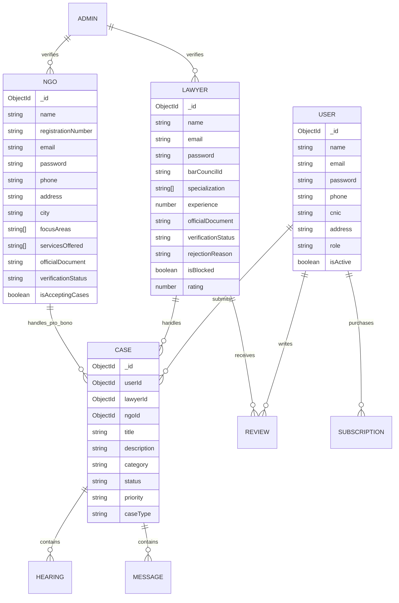

# Legal Link - System Specification & Architecture Document

> **Final Year Project (Session 2023–2027)**  
> **Degree:** BS in Software Engineering  
> **Department:** Department of Computer Science, COMSATS University Islamabad (CUI), Lahore Campus  
> **Group Members:**  
> - Farsab Husnain (SP23-BSE-061)  
> - Farwa Amin (SP23-BSE-062)  
> **Supervisor:** Sobia Usman (Assistant Professor)  

---

## 1. Executive Summary & Problem Statement

### 1.1 Project Overview
**Legal Link** is an AI-powered Legal Aid Portal designed for Pakistan's legal ecosystem. It bridges the gap between citizens, verified legal professionals (lawyers), and legal non-governmental organizations (NGOs). The platform combines natural language legal query assistance (supporting English and Roman Urdu), automated legal domain classification, verified directory listings, case management with hearing timeline tracking, dynamic legal document generation, and administrative moderation.

### 1.2 Problem Statement
In developing countries like Pakistan, accessing justice is hindered by:
- **Lack of Legal Literacy:** Citizens often do not know what legal domain their issue falls under or what their basic legal rights are.
- **Difficulty in Reaching Verified Professionals:** Finding an authentic lawyer traditionally requires visiting physical courts (*Kachehri*) and relying on unverified word-of-mouth references, exposing individuals to fraud and exploitation.
- **Financial Barriers:** High legal fees prevent low-income or marginalized individuals from seeking justice, while pro-bono NGO initiatives remain fragmented and hard to reach.
- **Absence of Modern Digital Systems:** Lack of centralized case tracking, standardized legal document generation, and verified legal directories.

### 1.3 Solution
Legal Link provides a centralized web platform that:
1. Employs an **AI Chatbot (Gemini / NLP)** to analyze user problems in plain language (English / Roman Urdu) and categorize them into legal areas (*Family, Criminal, Property, Labor, Fundamental Rights*).
2. Recommends **verified lawyers** based on expertise, rating, and location, or routes cases to **verified NGOs** for pro-bono and human rights support.
3. Offers **case tracking** with hearing milestones, status transitions, and real-time Socket.IO notifications.
4. Generates standard Pakistani **legal document templates** (affidavits, bail applications, FIR complaints, legal notices).
5. Provides **role-based access control** across four distinct actors: Citizen, Lawyer, NGO, and Administrator.

---

## 2. Stakeholders & Role-Based Access Control (RBAC)

The system supports four distinct roles:

| Role | Role Identifier | Responsibilities & Capabilities |
| :--- | :--- | :--- |
| **Citizen (Client)** | `user` | • Chat with AI legal assistant in English or Roman Urdu • Receive legal category analysis and guidance citations • Browse & filter verified Lawyers and NGOs • Subscribe to lawyer packages (Gold / Platinum) to unlock hiring • Submit legal cases & upload supporting files (up to 10MB) • Track case lifecycle and hearing dates • Generate and download legal document templates • Submit 1–5 star reviews for lawyers/NGOs after case completion |
| **Lawyer** | `lawyer` | • 4-step professional onboarding with Bar Council ID and certificate verification • Manage professional profile (specialization, courts, experience, fees, availability) • Review assigned client cases and pro bono inquiries • Update case statuses (`assigned` → `in_progress` → `resolved`) • Maintain case hearing dates, outcomes, and legal case analysis reports • Receive real-time client case notifications |
| **NGO Representative** | `ngo` | • Register organization with official registration certificate & focal person info • Manage NGO profile (focus areas, pro bono legal aid services, operating hours) • Accept / reject pro bono legal aid applications from citizens • Manage assigned cases, schedule hearings, and communicate with clients • Toggle pro bono case acceptance (`isAcceptingCases`) |
| **System Administrator** | `admin` | • Review and approve/reject Lawyer applications and verification documents • Review and approve/reject NGO registrations and legal credentials • Activate, deactivate, or ban user, lawyer, and NGO accounts • Moderate and remove fraudulent or abusive reviews • Manage legal document template library • View system analytics (query volumes, active cases, top-rated experts, user stats) |

---

## 3. Functional Requirements Summary

### 3.1 User Authentication & Profile (`FR_01` – `FR_03`)
- Form validation for full name, unique email, phone, CNIC/ID, and strong password (min 8 chars, 1 uppercase, 1 digit, 1 special char).
- Email verification / OTP activation.
- JWT-based authentication with 24-hour token validity.
- Profile management: update contact info, address, CNIC, profile avatar, and change password.

### 3.2 Role-Based Access Control (`FR_04`)
- Strict route guarding on both frontend and backend for `user`, `lawyer`, `ngo`, and `admin`.
- Role-specific dashboard redirection upon login.

### 3.3 AI Chatbot & Query Processing (`FR_05` – `FR_08`)
- Accepts queries in English and Roman Urdu.
- Categorizes queries into:
  - **Family Law** (Khula, divorce, child custody, maintenance, inheritance)
  - **Criminal Law** (FIR, bail, assault, cybercrime, harassment)
  - **Property Law** (Tenant disputes, illegal possession, land title, registry)
  - **Labor Law** (Unpaid wages, unlawful termination, workplace rights)
  - **Fundamental Rights** (Human rights, police harassment, illegal detention)
- Provides step-by-step guidance, references relevant Pakistani laws (e.g., PPC, CrPC, Family Courts Act), displays disclaimer, and provides clickable buttons to view matching verified lawyers or NGOs.
- Session persistence and previous chat history retrieval.

### 3.4 Lawyer Module (`FR_09` – `FR_11`)
- Searchable directory with filtering by name, specialization, city, fee range, and experience.
- Lawyer profile displays: Bar Council ID, experience years, specialization badges, verified status, client reviews.
- Subscription-based hiring:
  - **Gold Tier:** Lawyers with $\le 5$ years experience.
  - **Platinum Tier:** Senior lawyers with $\ge 5$ years experience or 50+ cases handled.
  - Payment simulation for EasyPaisa, JazzCash, and direct bank transfer.

### 3.5 NGO Module (`FR_12` – `FR_13`)
- Searchable NGO directory with filters for legal focus areas (Women Rights, Child Protection, Human Rights, Labor Rights, Prisoner Support) and cities.
- Detailed NGO profile showing mission statement, focal person contact, operating hours, and pro bono legal aid eligibility.
- In-app pro bono legal aid application form allowing citizens to request free assistance.

### 3.6 Case Management & Tracking (`FR_16` – `FR_17`)
- Case submission with title, description, category, and file attachments (up to 10MB).
- Case lifecycle transitions:
  $$\text{Submitted / Pending} \longrightarrow \text{Under Review} \longrightarrow \text{Assigned} \longrightarrow \text{In Progress} \longrightarrow \text{Resolved} \longrightarrow \text{Closed}$$
- Hearing timeline: scheduled dates, hearing notes, and case outcomes.
- Case analysis reports uploaded by assigned lawyers or NGOs.

### 3.7 Legal Document Automation (`FR_14` – `FR_15`)
- Pre-approved templates suited to Pakistani law:
  - Affidavits / Stamp Paper Declarations
  - FIR Complaint Applications
  - Bail Applications
  - Legal Notices (with formal "WHEREAS" clauses and signature blocks)
  - Rental & Property Agreements
- Dynamic form filler with live preview, PDF/DOCX generation, and print styling.

### 3.8 Reviews, Notifications & Admin Control (`FR_18` – `FR_21`)
- 1–5 star rating and written review system (restricted to 1 review per resolved case).
- Socket.IO real-time events for case status changes, hearing updates, and account status alerts.
- Admin verification queue: document review, approval, or rejection with detailed reason.

---

## 4. Technical Architecture & Data Models

### 4.1 Tech Stack
- **Frontend:** React.js, React Router v6, Tailwind CSS, Axios, Lucide Icons, Socket.io-client.
- **Backend:** Node.js, Express.js, Mongoose (MongoDB Atlas), Socket.io, Multer (file uploads), Bcryptjs, JsonWebToken.
- **AI & NLP:** Google Gemini API (`@google/generative-ai`) / Dialogflow, Python FastAPI service for advanced classification.

### 4.2 Core Database Entities

---

## 5. Implementation Roadmap for NGO Module

To complete the NGO Module as detailed in the FYP Mid Report:

1. **Backend NGO Schema (`backend/models/NGO.js`):**
   - Implement complete organization model with focal person, focus areas, verification status, and document storage.

2. **Case Schema Update (`backend/models/Case.js`):**
   - Add `ngoId` reference and `caseType` (`'paid'` vs `'pro_bono'`).
   - Add `'ngo'` to allowed sender types in messages.

3. **Backend NGO Routes (`backend/routes/ngoRoutes.js`):**
   - Registration with document upload (`multer`).
   - Login & JWT token generation (`role: 'ngo'`).
   - Profile retrieval & updates.
   - Pro bono cases retrieval & status updates.
   - Public directory endpoint with filters.

4. **Admin Verification for NGOs (`backend/routes/adminRoutes.js` & `AdminDashboard`):**
   - Endpoint to list pending NGOs.
   - Endpoint to approve or reject NGOs with reason.
   - Admin UI table in React with document preview and action buttons.

5. **Frontend Public & Portal Pages:**
   - Public: `NGODirectory.jsx` (Search/filter) and `NGOProfile.jsx` (Detail & Request Aid modal).
   - NGO Portal: `pages/ngo/Signup.js`, `pages/ngo/Login.js`, `pages/ngo/Dashboard.js`, `pages/ngo/Profile.js`.
   - Routing: Update `App.js` and Navbar links.
